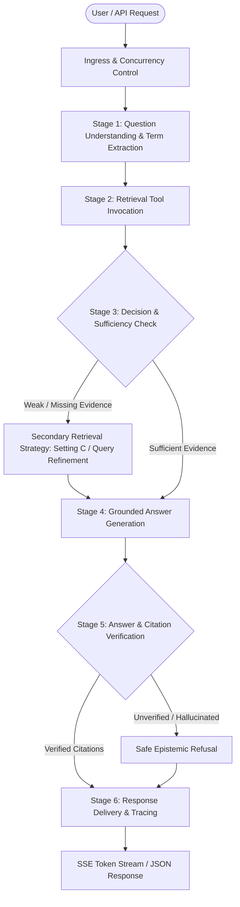

# The Relay — Production-Grade LLM Orchestration, RAG & Performance Engineering System

A production-grade question-answering assistant and retrieval-augmented generation (RAG) platform grounded exclusively in three foundational research papers. Engineered to operate under strict API rate limits, unpredictable network latency, burst traffic spikes, and constrained resources.

---

## 1. System Architecture

The Relay is structured as a 6-stage pipelined state machine:



### Research Corpus
1. **Attention Is All You Need** (arXiv 1706.03762v7)
2. **Moshi: a speech-text foundation model for real-time dialogue** (arXiv 2410.00037v1)
3. **Dynamic Chunking for End-to-End Hierarchical Sequence Modeling** (arXiv 2507.07955v2)

All PDFs are stored in `corpus/papers/` with SHA-256 integrity checksums tracked in `manifest.json`.

---

## 2. Directory Structure

```text
the-relay/
├── app/
│   ├── api/                 # FastAPI server (POST /ask, GET /health, GET /metrics, GET /config, Web UI)
│   ├── cli.py               # Interactive & scriptable CLI query engine
│   ├── core/                # Configuration, settings, token-bucket, circuit-breaker
│   ├── evaluation/          # 15 benchmark questions across balanced categories
│   ├── pipeline/            # Multi-stage orchestrator, question analyzer, citation verifier
│   ├── providers/           # Interchangeable providers (Real Groq API vs Controllable Stand-in Simulator)
│   ├── retrieval/           # PyMuPDF extractor, chunker, BM25, Dense, RRF reranker
│   ├── schemas/             # Pydantic models and request/response specifications
│   └── tools/               # RetrievalTool explicit tool invocation interface
├── configs/
│   ├── settings.yaml        # System-wide settings
│   ├── retrieval.yaml       # Presets for Configurations A, B, and C
│   └── simulator.yaml       # Calibrated stand-in inference parameters
├── corpus/
│   ├── papers/              # Versioned research PDFs and manifest.json
│   ├── processed/           # Extracted structured pages (120 pages)
│   └── indexes/             # Pre-computed dense embedding caches (.npy)
├── experiments/
│   ├── load_testing/        # Asyncio load-testing harness (5 scenarios + retry evaluation)
│   └── analysis/            # Table & metrics generators
├── submission/
│   ├── results.csv          # Exactly one row per tested request (170 requests)
│   ├── report.md            # Written final report with exact headings
│   ├── report.pdf           # 2-Page final report compiled via ReportLab
│   ├── assistant_prompts.md # Log of engineering interaction prompts
│   └── tables/              # Tables 1, 2a, 2b, 3 in CSV format
├── tests/                   # Pytest test suite covering retrieval, pipeline, and simulator
├── requirements.txt         # Pinned Python dependencies
├── pyproject.toml           # Project package specification
└── README.md
```

---

## 3. Installation & Setup

### Prerequisites
- Python 3.11+
- Virtual environment support

### Setup Virtual Environment
```bash
cd the-relay
python -m venv .venv

# On Windows:
.venv\Scripts\activate

# On Linux/macOS:
source .venv/bin/activate

# Install dependencies:
pip install -r requirements.txt
```

### Groq API Key Configuration
Create a `.env` file from `.env.example`:
```bash
cp .env.example .env
```
Edit `.env`:
```ini
GROQ_API_KEY=gsk_your_actual_key_here
GROQ_MODEL=qwen/qwen3.8-27b
RELAY_PROVIDER_MODE=real   # "real" or "stand-in"
```

---

## 4. Execution Commands

### 1. Run the Backend API Server
```bash
# Starts FastAPI server on http://127.0.0.1:8000
python -m uvicorn app.api.server:app --host 127.0.0.1 --port 8000 --reload
```
- Interactive Web Interface: Visit `http://127.0.0.1:8000/`
- Health check: `http://127.0.0.1:8000/health`
- Live telemetry metrics: `http://127.0.0.1:8000/metrics`
- System configuration: `http://127.0.0.1:8000/config`

### 2. Run Query via CLI
```bash
# Submit a streaming query using Configuration B
python -m app.cli --question "What is the Mimi audio codec in Moshi?" --setting B --stream

# Run non-streaming
python -m app.cli --question "What is Scaled Dot-Product Attention in the Transformer?" --setting A --no-stream

# Interactive mode
python -m app.cli --interactive
```

### 3. Run Automated Tests
```bash
pytest tests/ -v
```

### 4. Run Load Testing & Retrieval Experiments
```bash
# Executes all 5 load scenarios and 15 benchmark questions, generating submission/results.csv:
python experiments/load_testing/runner.py

# Recompute tables and metrics:
python experiments/analysis/generate_metrics.py

# Recompile the 2-page PDF report:
python scripts/generate_pdf_report.py
```

---

## 5. Retrieval Configurations

| Preset | Chunk Size | Overlap | Top K | Reranking | Purpose |
| :--- | :--- | :--- | :--- | :--- | :--- |
| **Config A** | 300 tokens | 50 tokens | 3 | Disabled | Minimal token footprint, fast single-pass |
| **Config B** | 500 tokens | 100 tokens | 5 | Disabled | Primary operational baseline |
| **Config C** | 500 tokens | 100 tokens | 5 | Enabled (Hybrid RRF) | Maximum precision for complex technical queries |

---

## 6. Grounding, Verification & Security

- **Evidence-grounded generation:** The LLM is instructed to answer exclusively using retrieved research-paper passages.
- **Citation verification:** Generated citations are checked against source metadata, including paper title, arXiv ID, version and page number.
- **Safe refusal:** Unsupported or unverifiable claims are replaced with a deterministic refusal response.
- **Pre-delivery verification:** The complete generated response is buffered internally and verified before being delivered to users through SSE.
- **API security:** API credentials are stored in environment variables, `.env` is excluded through `.gitignore`, and sensitive credentials are not exposed in application logs.
- **Controlled inference:** Configurable rate limiting, bounded retries, concurrency control and circuit breaking help manage provider failures and traffic spikes.

